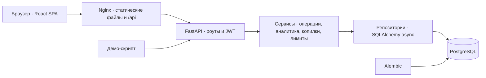

# Архитектура ФинСмарт

В режиме разработки Vite выполняет ту же маршрутизацию /api, что и Nginx.
FastAPI проверяет токен и передаёт идентификатор владельца сервису. Репозитории
ограничивают запросы этим идентификатором. Деньги хранятся как Numeric в рублях.
Границы периода формируются в финансовой часовой зоне, транзакции хранятся с временем UTC.

Импорт нормализует выписку, применяет правила категоризации и сохраняет операции
с уникальным хешем в рамках владельца. Аналитика агрегирует суммы из PostgreSQL.
Копилки записывают взносы отдельными строками. Месячные лимиты сопоставляются
с расходами выбранной категории в текущем календарном месяце.
